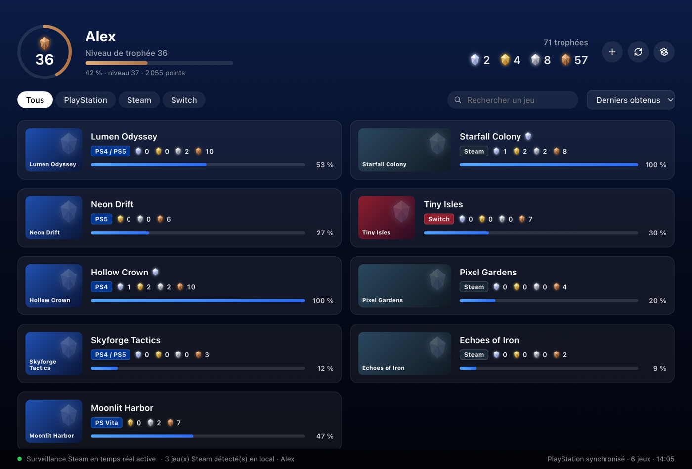
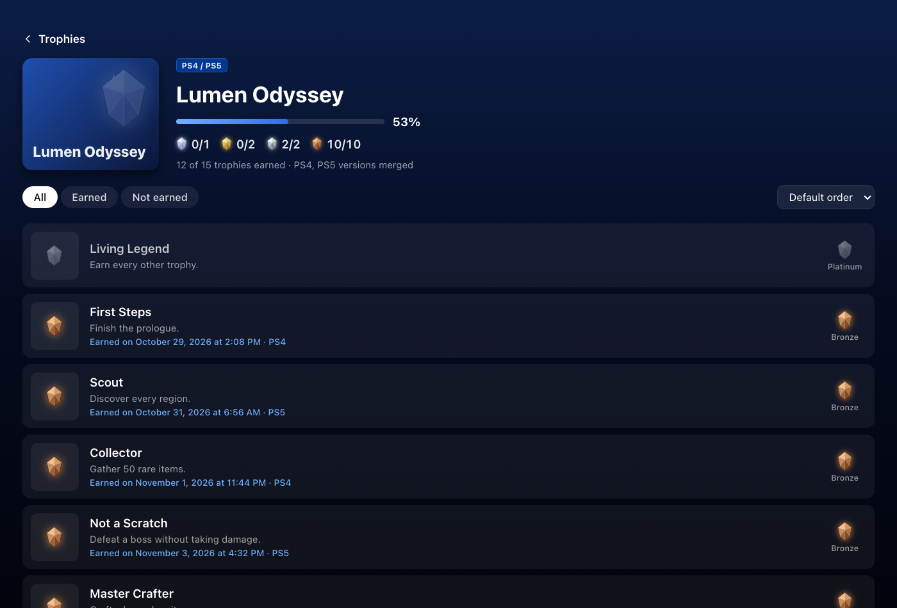
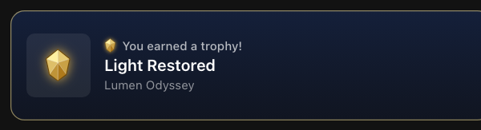
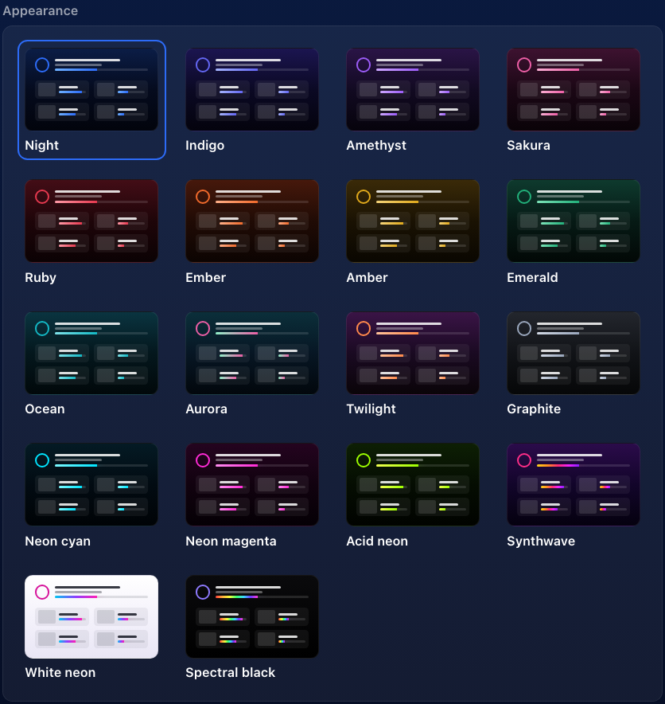

# Prisma

[](https://github.com/Larsylan/prisma/actions/workflows/tests.yml)
[](LICENSE)

*[Version française](README.md) — the app interface is in French.*

A console-style trophy system for **macOS, Windows and Linux**. It brings your **PlayStation trophies**, **Steam achievements** and **Nintendo Switch games** together in a single collection:
- 4 tiers: bronze, silver, gold and platinum;
- points and a trophy level from 1 to 999;
- an **instant notification on top of your game** as soon as an achievement unlocks.

Everything runs on your computer. No server, no leaderboards, no online statistics.



| Game page | Notification |
|---|---|
|  |  |

> **Unofficial project.** Prisma is not affiliated with Sony Interactive Entertainment, Valve or Nintendo. PlayStation, Steam and Nintendo Switch are trademarks of their respective owners. See [Disclaimer](#disclaimer).

## Features

- **Real-time Steam detection**: the app watches the files the Steam client writes on your computer and shows the notification milliseconds after Steam records the achievement. No account or setup needed.
- **PlayStation import**: all your PS3, PS4, PS5 and PS Vita trophies, with their original tiers and dates.
- **One game, one entry**: a game owned on several systems (PS3, PS4, PS5, PS Vita, Steam, Switch) appears once, with the trophies of every version merged.
- **Console trophies on your computer**: your PSN account is checked every 90 s, so a trophy earned on a PS5 or in Remote Play is announced too.
- **Full Steam history** (optional) through the Steam Web API.
- **Nintendo Switch games**: a catalog of 33 games, each with a PS5-style trophy list you tick as you progress. Any other game can be added with a generic list.
- **Unified tiers**: Steam has no tiers, so they are estimated automatically and can be changed by hand. Every Steam game also gets a **platinum**.
- **Notification card** shown above games without stealing keyboard or mouse focus, with a **crystal chime**.
- **Themes**: eighteen color themes, including glowing neons, a light theme and a spectral black, each previewed before being applied.
- **Original identity**: the hexagonal crystal emblem and the chime are created by the app itself.
- Lives in the **menu bar** (macOS) or **system tray** (Windows, Linux), even with the window closed, and can start at login.

## Supported systems

| System | Version | Notes |
|---|---|---|
| macOS | 11 Big Sur or later | The notification shows above full-screen games, on every desktop |
| Windows | 10 and 11 | Requires WebView2, built into Windows 11 and installed automatically otherwise |
| Linux | Recent distributions with WebKitGTK 4.1 | See [Known limitations](#known-limitations) for Wayland |

## Installation

Prisma is built from source. You need [Rust](https://rustup.rs) 1.87 or later and [Node.js](https://nodejs.org) 22. On Linux, also install (Debian / Ubuntu names):

```sh
sudo apt install libwebkit2gtk-4.1-dev libayatana-appindicator3-dev librsvg2-dev libasound2-dev libdbus-1-dev libxdo-dev
```

Then:

```sh
git clone https://github.com/Larsylan/prisma.git
cd prisma
npm ci
npm run tauri build
```

Installers are written to `target/release/bundle/`: `.app` and `.dmg` on macOS, `.msi` and `-setup.exe` on Windows, `.deb`, `.rpm` and `.AppImage` on Linux. On macOS, `./scripts/install-macos.sh` builds the app, installs it to `/Applications` and removes any other copy.

> The app is not signed by an identified developer. On first launch, allow it in macOS System Settings → Privacy & Security → **Open Anyway**, or click **More info** → **Run anyway** in Windows SmartScreen.

## Setup

### Steam

**Local mode (automatic, real time).** Nothing to configure. The app reads the Steam client's `appcache/stats` folder for the most recently signed-in account:

| System | Steam folder |
|---|---|
| macOS | `~/Library/Application Support/Steam` |
| Windows | Folder registered by Steam, otherwise `C:\Program Files (x86)\Steam` |
| Linux | `~/.steam/steam`, `~/.local/share/Steam` or the Flatpak install |

Only games **launched at least once on this computer** have these files.

**Steam Web API (optional, full history).**
1. Create a key at <https://steamcommunity.com/dev/apikey> (any domain name, for example `localhost`).
2. Paste it into Settings → Steam → **Clé Steam Web API**. It is kept in your system keychain, like the PlayStation access.
3. Your **SteamID64** is detected automatically; only fill it in for another account.
4. Click **Importer l'historique complet**. Your profile and game details must be **public**.

**Rarity-based tiers (optional).** The global unlock percentage of each achievement can be used to pick its tier. It is never displayed.

### PlayStation Network

The app signs in the same way as the PlayStation mobile app, using an **NPSSO** token.

1. Sign in at <https://www.playstation.com> in your browser.
2. In the same browser, open <https://ca.account.sony.com/api/v1/ssocookie>.
3. Copy the 64-character `npsso` value.
4. Paste it into Settings → PlayStation Network and click **Connecter**.

The token is only used once, to obtain an access stored in your **system keychain** (Keychain on macOS, Credential Manager on Windows, Secret Service on Linux), valid for about **2 months**.

> Never share your NPSSO token: it grants access to your PlayStation account.

### Nintendo Switch

The Switch has no achievement system, so each game gets a **hand-written, PS5-style trophy list**. Click **+** in the main window, pick a game from the catalog or type any title, then tick trophies on the game page as you earn them. The platinum unlocks automatically once all others are earned. Lists live in `crates/prisma-core/src/switch/catalog_data.rs`.

## Themes

Settings → **Apparence** offers eighteen color themes, each shown as a miniature of the main screen; a click applies it to the window and the notification card:
- **Classics**: Nuit (default), Indigo, Améthyste, Sakura, Rubis, Braise, Ambre, Émeraude, Océan, Aurore, Crépuscule, Graphite;
- **Neon**: Néon cyan, Néon magenta, Néon acide and Synthwave, vivid colors on a near-black background with glowing progress bars;
- **Blanc néon**: the only light theme, dark text on white with cyan, violet and pink progress;
- **Noir spectral**: deep black with rainbow progress bars.

A test checks that text, "earned" labels and accents stay readable on every theme.



## Tiers, points and levels

| Tier | Points |
|---|---|
| Bronze | 15 |
| Silver | 30 |
| Gold | 90 |
| Platinum | 300 |

Levels go from 1 to 999; the points required per level grow in bands of 100 levels (60, 90, 450, 900… up to 3,600). A game's progress is weighted by points, platinum excluded.

**Steam tiers** are chosen in this order: rarity if enabled (under 7 %: gold, under 25 %: silver, otherwise bronze), then keywords such as "100%", "all achievements" or "legendary" (gold), then hidden achievements (silver), otherwise bronze. Right-click an achievement to change its tier.

**Merged games**: titles are compared ignoring accents, case, punctuation, platform mentions and edition names ("GOTY", "Deluxe", "Director's Cut"…). Trophies with the same name are merged and count **once**, a game has a single platinum, and each earned trophy shows where it was earned. Grouping can be limited to PlayStation versions or turned off in Settings.

## Data and privacy

| Data | macOS | Windows | Linux |
|---|---|---|---|
| Library and settings | `~/Library/Application Support/Prisma/` | `%APPDATA%\Prisma\` | `~/.local/share/Prisma/` |
| Log | `~/Library/Logs/io.github.larsylan.prisma/` | `%LOCALAPPDATA%\io.github.larsylan.prisma\logs\` | `~/.local/share/io.github.larsylan.prisma/logs/` |
| PlayStation access and Steam Web API key | Keychain | Credential Manager | Secret Service |

The app only contacts Sony's PSN servers, the Steam Web API and store, and the image servers of Steam and Sony. It sends no data anywhere else and collects no usage statistics.

## Architecture

- **`crates/prisma-core`** (Rust) holds all the domain logic, with no UI: models, merge and grouping rules, data sources, persistence and chime synthesis. It is covered by unit tests.
- **The Tauri app** combines a Rust backend (`src-tauri`) handling sync, notifications and the tray icon, with a Svelte + TypeScript interface (`src`). `Services` creates each service once and wires them together, without singletons.

```
Steam client ──writes──▶ appcache/stats ──file events──▶ SteamLocalMonitor ─┐
PlayStationSync (every 90 s) ────────────────────────────────────────────────┼─▶ LibraryStore ─▶ Notifier
SteamWebImporter ────────────────────────────────────────────────────────────┘   (TrophyLibrary)
```

## Development

```sh
npm ci                                  # interface dependencies
npm run tauri dev                       # full app, reloaded on every change
npm run demo                            # interface alone in a browser, on a fictional library
npm run check                           # TypeScript and Svelte checks
npm test                                # interface tests (Vitest)
cargo test --workspace                  # core and app tests
cargo clippy --workspace --all-targets  # Rust lints
cargo run -p prisma-core --example dump # list locally read Steam achievements
```

To simulate an unlock, write a fake Steam client, run the app on it, then unlock an achievement:
```sh
cargo run -p prisma-core --features test-support --example steam_fixture -- /tmp/steam
PRISMA_STEAM_ROOT=/tmp/steam PRISMA_DATA_DIR=/tmp/prisma npm run tauri dev
cargo run -p prisma-core --features test-support --example steam_fixture -- /tmp/steam unlock
```

Besides the tests, CI builds the installers for each system, installs them and runs the app on that fake Steam client (`scripts/smoke-test.py`); the screenshots are attached to every run.

| Environment variable | Effect |
|---|---|
| `PRISMA_STEAM_ROOT` | Simulated Steam folder, with `appcache/stats` and `config/loginusers.vdf` |
| `PRISMA_DATA_DIR` | Separate library. In this mode the app does not use the PSN account stored in the system keychain |

## Known limitations

- Real-time detection only works for games using Steam achievements.
- PlayStation trophies come from Sony's servers and are checked every 90 s.
- Switch trophies are ticked by hand, and Steam tiers are an estimate.
- **Windows**: the notification shows above borderless or windowed full-screen games, not exclusive full-screen ones.
- **Linux**: on Wayland the desktop decides window placement, and GNOME does not let an app appear above a full-screen game. Notifications work fully on X11 and KDE Plasma.

## Uninstall

Turn off launch at login in the app settings first, then:
- **macOS**: delete `/Applications/Prisma.app`, `~/Library/Application Support/Prisma` and the `io.github.larsylan.prisma` Keychain item;
- **Windows**: uninstall Prisma from Settings → Apps, delete `%APPDATA%\Prisma` and the `io.github.larsylan.prisma` Credential Manager entry;
- **Linux**: remove the package, delete `~/.local/share/Prisma` and the `io.github.larsylan.prisma` keyring entry.

## Disclaimer

Prisma is a personal, unofficial, non-commercial project. It is not affiliated with, endorsed or sponsored by Sony Interactive Entertainment, Valve Corporation or Nintendo.

- PlayStation Network access relies on the **undocumented API** of the PlayStation mobile app, using that app's public client credentials. Sony does not authorize its use by third-party software, and it may breach the PlayStation Network terms of service. Use it at your own risk.
- The NPSSO token and the access derived from it stay on your computer, in the system keychain. They are only ever sent to Sony.
- The Switch trophy lists are written for this project; they are not official achievements.
- The crystal emblem and the chime are original creations.

## License

Released under the [MIT License](LICENSE).
