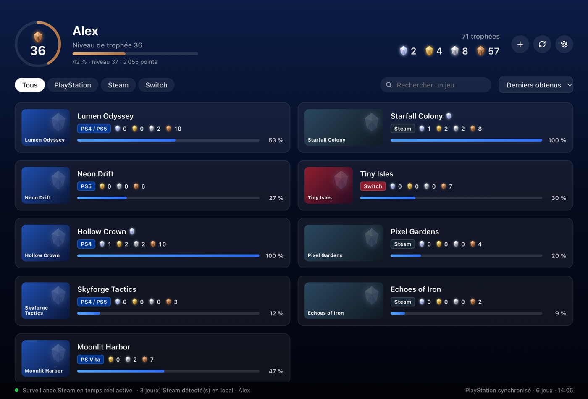
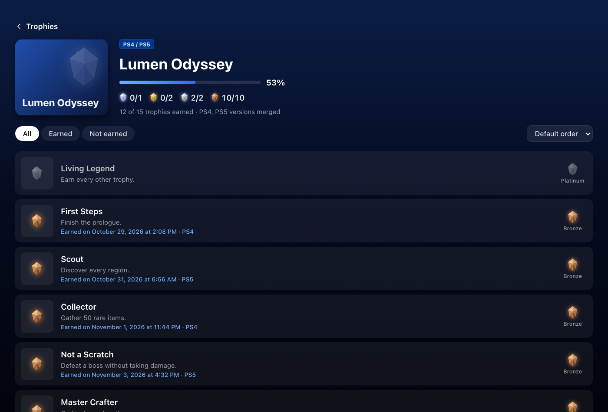
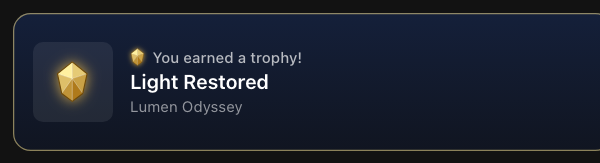
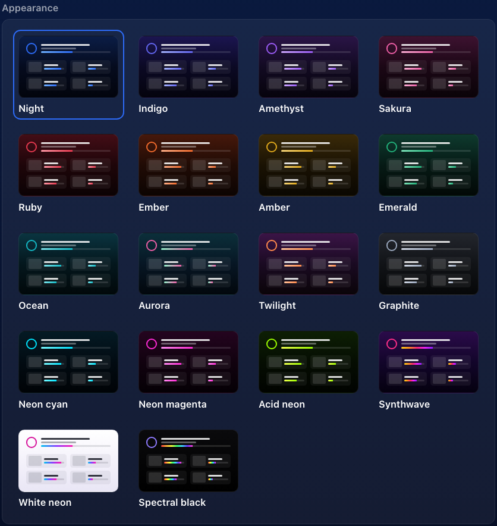

# Prisma : suivi des trophées PlayStation, Steam et Nintendo Switch

[](https://github.com/Larsylan/prisma/releases/latest)
[](https://github.com/Larsylan/prisma/actions/workflows/tests.yml)

[](LICENSE)

*[English version](README.md)*

**Prisma** est un système de **trophées et de succès** gratuit et open source pour **macOS, Windows et Linux**. Il réunit vos **trophées PlayStation (PSN)**, vos **succès Steam** et vos **jeux Nintendo Switch** dans une seule collection, façon console :
- 4 grades : bronze, argent, or et platine ;
- des points et un niveau de trophée de 1 à 999 ;
- une **notification de trophée instantanée par-dessus le jeu** dès qu'un succès Steam est débloqué.

Tout est calculé sur votre ordinateur. Il n'y a ni serveur, ni compte à créer, ni classement, ni statistique en ligne.



| Fiche d'un jeu | Notification de trophée |
|---|---|
|  |  |

## Téléchargement

Téléchargez l'installateur de votre système dans la **[dernière version](https://github.com/Larsylan/prisma/releases/latest)** : `.dmg` pour macOS (Apple Silicon et Intel), `-setup.exe` ou `.msi` pour Windows, `.deb`, `.rpm` ou `.AppImage` pour Linux. Rien à compiler.

> Les installateurs ne sont pas signés par un développeur identifié. Au premier lancement, macOS demande d'autoriser Prisma dans Réglages Système → Confidentialité et sécurité → **Ouvrir quand même**. Windows SmartScreen affiche **Informations complémentaires** → **Exécuter quand même**.

> **Projet non officiel.** Prisma n'est affilié ni à Sony Interactive Entertainment, ni à Valve, ni à Nintendo. PlayStation, Steam et Nintendo Switch sont des marques de leurs propriétaires respectifs. Voir [Avertissement](#avertissement).

---

## Sommaire

1. [Téléchargement](#téléchargement)
2. [Fonctionnalités](#fonctionnalités)
3. [Systèmes pris en charge](#systèmes-pris-en-charge)
4. [Compiler depuis les sources](#compiler-depuis-les-sources)
5. [Premier lancement](#premier-lancement)
6. [Configurer Steam](#configurer-steam)
7. [Configurer PlayStation Network](#configurer-playstation-network)
8. [Jeux Nintendo Switch](#jeux-nintendo-switch)
9. [Notifications](#notifications)
10. [Thèmes](#thèmes)
11. [Regroupement des jeux multi-plateformes](#regroupement-des-jeux-multi-plateformes)
12. [Grades, points et niveaux](#grades-points-et-niveaux)
13. [Utiliser l'interface](#utiliser-linterface)
14. [Données et confidentialité](#données-et-confidentialité)
15. [Fonctionnement technique](#fonctionnement-technique)
16. [Dépannage](#dépannage)
17. [Limites connues](#limites-connues)
18. [Développement](#développement)
19. [Désinstallation](#désinstallation)
20. [Avertissement](#avertissement)
21. [Licence](#licence)

---

## Fonctionnalités

- **Détection Steam en temps réel** : l'app surveille les fichiers que le client Steam écrit sur votre ordinateur. La notification apparaît quelques millisecondes après que Steam a enregistré le succès. Aucun compte ni réglage n'est nécessaire.
- **Import PlayStation** : tous vos trophées PS3, PS4, PS5 et PS Vita, avec leurs grades d'origine et leurs dates d'obtention.
- **Un jeu = une entrée** : un jeu possédé sur plusieurs systèmes (PS3, PS4, PS5, PS Vita, **Steam et Switch**) n'a qu'une seule entrée, avec les trophées de toutes ses versions fusionnés.
- **Notification des trophées gagnés sur console** : l'app vérifie votre compte PSN toutes les 90 s. Un trophée gagné sur PS5, ou en Remote Play, s'affiche aussi sur l'ordinateur.
- **Historique Steam complet** (optionnel), via la Steam Web API.
- **Jeux Nintendo Switch** : un catalogue de 33 jeux (dont tous les Xenoblade et tous les Pokémon de la Switch), chacun avec sa liste de trophées sur le modèle PS5, à cocher au fil de votre progression. Tout autre jeu peut être ajouté avec une liste générique.
- **Uniformisation** : Steam n'a pas de grades. Ils sont attribués automatiquement et restent modifiables à la main. Chaque jeu Steam reçoit aussi un **platine**.
- **Carte de notification** affichée au-dessus des jeux, sans prendre le focus du clavier ni de la souris, accompagnée d'un **carillon cristallin**.
- **Thèmes** : dix-huit thèmes de couleur, dont des néons lumineux, un thème clair et un noir spectral, chacun prévisualisé avant d'être appliqué.
- **Identité originale** : l'emblème est un cristal hexagonal à facettes et le son est synthétisé par l'app. Aucun visuel ni son ne provient d'une autre marque.
- L'app tourne **dans la barre des menus** (macOS) ou **la zone de notification** (Windows, Linux), même fenêtre fermée. Elle peut se lancer à l'ouverture de session.

## Systèmes pris en charge

| Système | Version | Remarques |
|---|---|---|
| macOS | 11 Big Sur ou plus récent | La notification passe au-dessus des jeux en plein écran, sur tous les bureaux |
| Windows | 10 et 11 | Nécessite WebView2, déjà présent sur Windows 11 et installé automatiquement sinon |
| Linux | Distributions récentes avec WebKitGTK 4.1 | Voir [Limites connues](#limites-connues) pour Wayland |

## Compiler depuis les sources

Pour compiler Prisma vous-même plutôt que d'utiliser les [installateurs](#téléchargement), il vous faut :
- [Rust](https://rustup.rs) 1.87 ou plus récent ;
- [Node.js](https://nodejs.org) 22 ;
- sous Linux, les bibliothèques de développement suivantes (noms Debian / Ubuntu) :

  ```sh
  sudo apt install libwebkit2gtk-4.1-dev libayatana-appindicator3-dev librsvg2-dev libasound2-dev libdbus-1-dev libxdo-dev
  ```

Puis :

```sh
git clone https://github.com/Larsylan/prisma.git
cd prisma
npm ci
npm run tauri build
```

Les installateurs sont créés dans `target/release/bundle/` :

| Système | Fichiers produits |
|---|---|
| macOS | `macos/Prisma.app` et `dmg/Prisma_….dmg` |
| Windows | `msi/Prisma_….msi` et `nsis/Prisma_…-setup.exe` |
| Linux | `deb/Prisma_….deb`, `rpm/Prisma-….rpm` et `appimage/Prisma_….AppImage` |

Sur macOS, `./scripts/install-macos.sh` compile l'app, l'installe dans `/Applications` et retire toute autre copie.

## Premier lancement

1. Lancez **Prisma**. Une icône cristal apparaît dans la barre des menus (ou la zone de notification) et la fenêtre principale s'ouvre.
2. Si Steam est installé, vos jeux Steam déjà lancés sur cet ordinateur s'affichent tout de suite, sans aucune configuration.
3. Ouvrez les **Réglages** (roue dentée en haut à droite) :
   - saisissez votre nom affiché ;
   - connectez PlayStation Network (voir plus bas) ;
   - ajoutez si vous le souhaitez une clé Steam Web API ;
   - activez **Lancer à l'ouverture de session** pour que la détection soit toujours active.
4. Testez une notification : Réglages → Notifications → un bouton par grade.

## Configurer Steam

### Mode local (automatique, temps réel)

Rien à configurer. L'app lit le dossier `appcache/stats` du client Steam :

| Système | Dossier Steam |
|---|---|
| macOS | `~/Library/Application Support/Steam` |
| Windows | Dossier indiqué dans le registre, sinon `C:\Program Files (x86)\Steam` |
| Linux | `~/.steam/steam`, `~/.local/share/Steam` ou la version Flatpak |

- `UserGameStatsSchema_<appid>.bin` contient la liste des succès du jeu (noms et descriptions en français, icônes, succès cachés) ;
- `UserGameStats_<compte>_<appid>.bin` contient les succès débloqués et leurs dates.

Le compte utilisé est le dernier connecté dans Steam (fichier `config/loginusers.vdf`). Seuls les jeux **lancés au moins une fois sur cet ordinateur** possèdent ces fichiers. Pour les autres, utilisez la Steam Web API.

### Steam Web API (optionnel, historique complet)

1. Créez une clé sur <https://steamcommunity.com/dev/apikey>. Le nom de domaine demandé n'a pas d'importance, par exemple `localhost`.
2. Collez-la dans Réglages → Steam → **Clé Steam Web API**. Elle est rangée dans le coffre de votre système, comme l'accès PlayStation.
3. Le **SteamID64** est détecté automatiquement. Renseignez-le à la main uniquement s'il est absent ou si vous suivez un autre compte (17 chiffres, commençant par `7656119…`).
4. Cliquez sur **Importer l'historique complet**.

Votre profil Steam et vos **détails de jeu** doivent être **publics** : Steam → Profil → Modifier → Paramètres de confidentialité. L'import analyse tous les jeux auxquels vous avez joué au moins une minute et se relance à chaque démarrage de l'app.

### Grades par rareté (optionnel)

L'option **Calculer les grades via la rareté Steam** récupère le pourcentage mondial de joueurs ayant obtenu chaque succès. Ce chiffre sert **uniquement** à choisir le grade : il n'est jamais affiché. Voir [Grades](#attribution-des-grades-steam).

## Configurer PlayStation Network

L'app utilise le même mécanisme de connexion que l'application mobile PlayStation, via un jeton **NPSSO**.

1. Dans votre navigateur, connectez-vous sur <https://www.playstation.com>.
2. Dans le même navigateur, ouvrez <https://ca.account.sony.com/api/v1/ssocookie>.
3. La page affiche `{"npsso":"xxxxxxxx…"}`. Copiez la valeur, soit 64 caractères sans les guillemets.
4. Dans Réglages → PlayStation Network, collez-la dans **Jeton NPSSO**, puis cliquez sur **Connecter**.

Le jeton ne sert qu'une fois : il permet d'obtenir un accès enregistré dans le **coffre de votre système** (Trousseau sur macOS, Gestionnaire d'identification sur Windows, Secret Service sur Linux). Cet accès reste valable environ **2 mois**. Ensuite, refaites la procédure.

| Option | Effet |
|---|---|
| Notifier les trophées gagnés sur console | Vérifie votre compte toutes les 90 s et affiche une notification pour chaque nouveau trophée |
| Synchroniser maintenant | Recharge les jeux modifiés depuis la dernière synchronisation |
| Déconnecter | Supprime l'accès du coffre. Cochez « Supprimer les trophées importés » pour retirer aussi les jeux PlayStation |

> Ne partagez jamais votre jeton NPSSO : il donne accès à votre compte PlayStation.

## Jeux Nintendo Switch

La Switch n'a pas de système de succès, et Nintendo n'en expose aucun. L'app fournit donc, pour chaque jeu, une **liste de trophées écrite sur le modèle PS5** : une dizaine de bronzes, quelques argents, un ou plusieurs ors, et un **platine** obtenu automatiquement quand tous les autres le sont.

1. Cliquez sur **+** en haut à droite de la fenêtre principale.
2. Choisissez un jeu du catalogue, ou saisissez le titre d'un autre jeu : il recevra une liste générique (premiers pas, boss, fin de l'histoire, 100 %, difficulté maximale…).
3. Dans la fiche du jeu, cochez le cercle à droite d'un trophée quand vous l'avez obtenu (ou clic droit → **Marquer comme obtenu**). La notification et le carillon se déclenchent comme pour un vrai déblocage.

Catalogue (33 jeux) : Animal Crossing: New Horizons, Détective Pikachu : Le Retour, Donkey Kong Country: Tropical Freeze, Fire Emblem: Three Houses, Kirby et le monde oublié, Légendes Pokémon : Arceus, Légendes Pokémon : Z-A, Luigi's Mansion 3, Mario Kart 8 Deluxe, Metroid Dread, New Pokémon Snap, Pikmin 4, Pokémon : Let's Go, Pikachu et Let's Go, Évoli, Pokémon Café ReMix, Pokémon Diamant Étincelant et Perle Scintillante, Pokémon Donjon Mystère : Équipe de Secours DX, Pokémon Écarlate et Violet, Pokémon Épée et Bouclier, Pokémon Quest, Pokémon Unite, Pokkén Tournament DX, Splatoon 3, Super Mario Bros. Wonder, Super Mario Odyssey, Super Smash Bros. Ultimate, The Legend of Zelda: Breath of the Wild, The Legend of Zelda: Tears of the Kingdom, Xenoblade Chronicles 2, Xenoblade Chronicles 2: Torna – The Golden Country, Xenoblade Chronicles 3, Xenoblade Chronicles 3: Future Redeemed, Xenoblade Chronicles X: Definitive Edition, Xenoblade Chronicles: Definitive Edition.

Les listes sont définies dans `crates/prisma-core/src/switch/catalog_data.rs`. Une liste modifiée s'applique au prochain lancement, sans perdre les trophées déjà cochés (sauf ceux qui ont été renommés ou supprimés). Un jeu Switch se retire depuis sa fiche : **Retirer de la bibliothèque**.

## Notifications

La carte s'affiche en haut de l'écran où se trouve le pointeur. Elle ne capte ni le clavier ni la souris : le jeu ne perd jamais le focus.

| Réglage | Valeurs |
|---|---|
| Son | Activé ou désactivé |
| Position | En haut à droite (par défaut) ou en haut à gauche |
| Durée | De 3 à 12 secondes (6 par défaut) |

- Quand plusieurs trophées tombent en même temps, ils s'affichent **l'un après l'autre**, du plus ancien au plus récent. Le **platine arrive toujours en dernier**.
- Le son a deux versions :
  - **bronze, argent et or** : trois notes montantes au timbre de cloche, puis un scintillement ;
  - **platine** : une montée de six notes, puis un accord tenu.
- Les trophées obtenus pendant que l'app était fermée sont ajoutés sans notification au lancement suivant.

## Thèmes

Réglages → **Apparence** présente dix-huit thèmes de couleur, chacun sous forme de miniature de l'écran principal. Un clic l'applique aussitôt, à la fenêtre comme à la carte de notification.



| Famille | Thèmes |
|---|---|
| Classiques | Nuit (par défaut), Indigo, Améthyste, Sakura, Rubis, Braise, Ambre, Émeraude, Océan, Aurore, Crépuscule, Graphite |
| Néon | Néon cyan, Néon magenta, Néon acide, Synthwave : des couleurs vives sur un fond presque noir, avec des barres de progression qui brillent |
| Blanc néon | Le seul thème clair : texte sombre sur fond blanc, progression cyan, violet et rose |
| Noir spectral | Noir profond, barres de progression aux couleurs de l'arc-en-ciel |

Un test vérifie que, sur chaque thème, le texte, les mentions « Obtenu » et la couleur d'accent restent lisibles sur le fond. Sur les boutons principaux, le texte passe automatiquement en noir ou en blanc selon la couleur d'accent.

## Regroupement des jeux multi-plateformes

Quand un même jeu existe sur plusieurs systèmes (PS3, PS4, PS5, PS Vita, Steam, Switch), l'app n'en affiche **qu'une seule entrée**. Par exemple, « Ghost of Tsushima » (PS4), « Ghost of Tsushima™ (PS5) » et « Ghost of Tsushima DIRECTOR'S CUT » (Steam) deviennent une seule entrée, étiquetée **PS4 / PS5 / Steam**.

**Reconnaissance du jeu.** Les titres sont comparés sans tenir compte :
- des accents, des majuscules, de la ponctuation et des symboles ™ ® ;
- des mentions de plateforme (« PS5 », « (PS4) », « PlayStation 5 », « PS Vita »…) ;
- des mentions d'édition (« Game of the Year », « GOTY », « Definitive », « Complete », « Deluxe », « Ultimate », « Enhanced », « Director's Cut », « Edition »).

Un remaster ou une version au titre différent (« … Remastered », « … Special Edition ») reste une entrée séparée.

**Fusion des trophées.**

| Règle | Détail |
|---|---|
| Reconnaissance | Deux trophées qui portent le même nom (accents, casse et ponctuation ignorés) sont fusionnés, quelle que soit la plateforme |
| Platine | Un seul platine par jeu. Le platine PlayStation et les platines générés pour Steam et Switch sont fusionnés |
| Obtention | Un trophée compte comme obtenu dès qu'il l'a été sur l'une des versions. La date retenue est la plus ancienne |
| Grade | Le grade PlayStation, qui est officiel, l'emporte sur le grade estimé de Steam. Entre versions PlayStation, la plus récente fait foi |
| Trophées propres à une version | Extensions et succès exclusifs, sur Steam ou une console, s'ajoutent à la liste |
| Affichage | Chaque trophée obtenu indique où il l'a été, par exemple « Obtenu le 14 juillet 2017 · PS5, Steam » |
| Points | Un trophée fusionné ne rapporte ses points **qu'une fois**. Votre total peut donc être inférieur à la somme des plateformes |

Le titre, la jaquette et les icônes viennent de la version PlayStation la plus récente. Steam ne les fournit que s'il n'existe pas de version PlayStation. Une entrée regroupée apparaît avec les filtres **PlayStation** et **Steam**. Le clic droit pour changer le grade reste disponible sur les succès qui ne viennent que de Steam.

**Réglage** (Réglages → Regroupement) :
- **Toutes les plateformes** : par défaut ;
- **Versions PlayStation uniquement** ;
- **Aucun regroupement**.

Chaque version reste enregistrée séparément : changer de mode est immédiat et ne nécessite aucune resynchronisation.

## Grades, points et niveaux

### Points par grade

| Grade | Points |
|---|---|
| Bronze | 15 |
| Argent | 30 |
| Or | 90 |
| Platine | 300 |

### Niveau de trophée

Le niveau va de 1 à 999. Le nombre de points nécessaires pour gagner un niveau augmente par tranches :

| Niveaux | Points par niveau |
|---|---|
| 1 → 99 | 60 |
| 100 → 199 | 90 |
| 200 → 299 | 450 |
| 300 → 399 | 900 |
| 400 → 499 | 1 350 |
| 500 → 599 | 1 800 |
| 600 → 699 | 2 250 |
| 700 → 799 | 2 700 |
| 800 → 899 | 3 150 |
| 900 → 999 | 3 600 |

La couleur du badge de niveau dépend du niveau :
- **bronze** de 1 à 99 ;
- **argent** de 100 à 299 ;
- **or** de 300 à 599 ;
- **platine** à partir de 600.

### Progression d'un jeu

La progression est calculée **en points**, sans compter le platine. Un trophée d'or pèse donc 6 fois plus qu'un bronze.

### Attribution des grades Steam

Les grades sont choisis selon les règles suivantes, dans cet ordre :

1. **Rareté** (si l'option est activée) :
   - moins de 7 % des joueurs : **or** ;
   - moins de 25 % : **argent** ;
   - sinon : **bronze**.
2. **Mots-clés** dans le nom ou la description, par exemple « 100% », « tous les », « terminer le jeu », « légendaire », « cauchemar », « maître », « parfait » : **or**.
3. **Succès caché** : **argent**.
4. Dans tous les autres cas : **bronze**.

Vous pouvez changer le grade d'un succès Steam par **clic droit** → Grade du trophée. Le choix est conservé. Utilisez « Rétablir le grade automatique » pour revenir au calcul de l'app.

### Platine Steam

Chaque jeu Steam qui compte **au moins 5 succès** reçoit un platine supplémentaire. Il se débloque automatiquement quand tous les autres succès du jeu sont obtenus. Sa date est celle du dernier succès débloqué. Les jeux PlayStation gardent leur platine d'origine, quand ils en ont un.

## Utiliser l'interface

**Écran principal**
- En haut : le badge de niveau, la progression vers le niveau suivant, votre total de points et le nombre de trophées par grade.
- Des filtres **Tous**, **PlayStation**, **Steam** et **Switch**, une recherche par titre et trois tris : derniers obtenus, progression, ordre alphabétique.
- Le bouton ↻ synchronise toutes les sources. La roue dentée ouvre les réglages.
- En bas : l'état de la surveillance Steam (pastille verte quand elle est active) et l'état de la synchronisation PlayStation.

**Fiche d'un jeu** (cliquez sur une carte)
- Filtres **Tous**, **Obtenus** et **Non obtenus**, et tris par ordre du jeu, par date ou par grade.
- Un trophée caché non obtenu s'affiche comme « Trophée caché ». Le bouton **Afficher** révèle son nom et sa description.
- La touche Échap ou le bouton « ‹ Trophées » ramène à l'écran principal.

**Icône de la barre des menus ou de la zone de notification**
- Votre niveau, votre nombre de platines et vos 5 derniers trophées.
- Ouvrir Prisma, Réglages, Notification de test, Synchroniser, Quitter.

Fermer la fenêtre **ne quitte pas** l'app : la détection continue. Pour l'arrêter complètement, choisissez Quitter depuis l'icône.

## Données et confidentialité

| Donnée | macOS | Windows | Linux |
|---|---|---|---|
| Bibliothèque et réglages (`library.json`, `settings.json`) | `~/Library/Application Support/Prisma/` | `%APPDATA%\Prisma\` | `~/.local/share/Prisma/` |
| Journal | `~/Library/Logs/io.github.larsylan.prisma/` | `%LOCALAPPDATA%\io.github.larsylan.prisma\logs\` | `~/.local/share/io.github.larsylan.prisma/logs/` |
| Accès PlayStation et clé Steam Web API | Trousseau | Gestionnaire d'identification | Secret Service (GNOME Keyring, KWallet…) |

Les éléments du coffre sont enregistrés sous le service `io.github.larsylan.prisma`, comptes `psn` et `steam-api-key`.

L'app ne contacte que les adresses suivantes :

| Service | Usage |
|---|---|
| `ca.account.sony.com` et `m.np.playstation.com` | Connexion PSN et trophées PlayStation |
| `api.steampowered.com` | Steam Web API (si une clé est renseignée) et rareté (si l'option est activée) |
| `store.steampowered.com` | Nom officiel d'un jeu quand le cache local n'en fournit qu'un nom de code |
| `cdn.cloudflare.steamstatic.com` et serveurs d'images Sony | Icônes et jaquettes |

L'app n'envoie aucune donnée à un autre service et ne collecte aucune statistique d'utilisation.

## Fonctionnement technique

```
Jeu ──débloque──▶ Client Steam ──écrit──▶ appcache/stats/UserGameStats_*.bin
                                              │ surveillance du système de fichiers
                                              ▼
                              SteamLocalMonitor ─▶ SteamClientCache
                                              │  (lecture du format binaire Valve)
                                              ▼
       PlayStationSync ──────▶   LibraryStore::record   ◀────── SteamWebImporter
       (toutes les 90 s)              │  TrophyLibrary::integrate : fusion,
                                      │  grades choisis, platine
                                      ▼
                        Notifier ─▶ fenêtre de notification + carillon
```

- **Surveillance** : notifications du système de fichiers (FSEvents, inotify ou ReadDirectoryChangesW), complétées par une vérification des dates de modification toutes les 2 s. Si Steam est en train d'écrire le fichier, la lecture est retentée jusqu'à 6 fois toutes les 100 ms.
- **Fusion** : un trophée déjà obtenu reste obtenu, même si une autre source l'ignore (cache local vide, par exemple). Ne déclenchent une notification que les trophées réellement nouveaux, détectés pendant que l'app tourne.
- **Fenêtre de notification** : fenêtre transparente, toujours au premier plan et transparente aux clics. Sur macOS, elle utilise le niveau `CGShieldingWindowLevel` et s'affiche sans activer l'app. Sur Windows, c'est une fenêtre outil qui ne s'active jamais.
- **Son** : synthétisé une fois par grade (modulation de fréquence façon cloche), puis converti en WAV en mémoire.

### Structure du projet

Le code est découpé en deux parties :
- **`crates/prisma-core`** (Rust) contient tout le métier, sans aucune interface : modèles, règles de fusion et de regroupement, lecture des sources, persistance, synthèse du son.
- **L'app Tauri** réunit un backend Rust (`src-tauri`), qui gère la synchronisation, les notifications et l'icône, et une interface Svelte + TypeScript (`src`). `Services` crée chaque service une seule fois et les relie entre eux, sans singleton. Les services ne parlent à Tauri qu'à travers deux interfaces étroites (`Ui`, `Announcer`), remplacées par des doublures dans les tests.

Le cœur, les services de l'app et les composants de l'interface ont chacun leurs tests ; la CI les lance sur macOS, Windows et Linux. Elle produit aussi les installateurs de chaque système, les installe et lance l'app sur un faux client Steam pour vérifier qu'elle détecte et annonce un succès (`scripts/smoke-test.py`, captures d'écran jointes à chaque exécution).

```
prisma/
├── assets/                     Icônes sources (SVG)
├── crates/prisma-core/src/
│   ├── domain/                 Game, Trophy, TrophyTier, GameId, niveaux, statistiques
│   ├── library/                TrophyLibrary (fusion, grades, platine), GameGrouper, library.json
│   ├── steam/                  Cache local du client, Steam Web API, format KeyValues, grades estimés
│   ├── playstation/            Connexion OAuth et API des trophées PSN
│   ├── switch/                 Catalogue des listes de trophées Switch
│   ├── support/                HTTP, coffre à secrets, texte
│   ├── theme/                  Couleurs et thèmes
│   └── chime.rs                Synthèse du carillon
├── src-tauri/src/
│   ├── main.rs                 Point d'entrée, fenêtres, commandes enregistrées
│   ├── services.rs             Racine de composition
│   ├── store.rs                État de la bibliothèque, sauvegarde, regroupement à l'affichage
│   ├── sync/                   Surveillance Steam, imports Steam Web et PSN, jeux Switch
│   ├── notifications/          File des notifications, fenêtre par système, lecture du son
│   ├── themes.rs               Noms des thèmes proposés dans les réglages
│   ├── commands.rs, views.rs   Commandes et données échangées avec l'interface
│   └── tray.rs                 Icône de la barre des menus ou de la zone de notification
├── src/                        Interface Svelte (écrans, composants, mode démo)
└── scripts/install-macos.sh    Compilation et installation sur macOS
```

## Dépannage

| Problème | Solution |
|---|---|
| Aucun jeu Steam | Lancez au moins une fois le jeu sur cet ordinateur, ou ajoutez une clé Steam Web API. Vérifiez avec `cargo run -p prisma-core --example dump` (voir ci-dessous) |
| Pas de notification en jeu | Vérifiez que la pastille en bas de la fenêtre est **verte**. Testez avec Réglages → Notifications. L'app doit être lancée : activez le lancement à l'ouverture de session |
| Notification affichée sur le mauvais écran | Elle apparaît sur l'écran où se trouve le pointeur |
| « Jeton NPSSO invalide ou expiré » | Reconnectez-vous sur playstation.com, puis récupérez un nouveau jeton |
| Erreur HTTP 403 avec Steam Web API | Profil ou détails de jeu privés, ou clé incorrecte |
| Nom de jeu du type « Jeu Steam 12345 » | Le nom officiel n'a pas pu être récupéré (pas de connexion). Il sera corrigé à la prochaine synchronisation |
| Le trousseau demande une autorisation (macOS) | Normal après une recompilation, car la signature locale change. Cliquez sur « Toujours autoriser » |
| Pas d'icône dans la zone de notification (Linux) | Sous GNOME, installez l'extension « AppIndicator and KStatusNotifierItem Support » |

### Diagnostic

```sh
# Liste les succès Steam lus en local (compte, jeux, succès obtenus)
cargo run -p prisma-core --example dump

# Même chose pour un autre dossier Steam
cargo run -p prisma-core --example dump -- /chemin/vers/Steam
```

Le journal de l'app (voir [Données](#données-et-confidentialité)) indique chaque trophée détecté.

## Limites connues

- **Le temps réel repose sur Steam** : il ne fonctionne que pour les jeux qui passent par le système de succès Steam. Les jeux d'autres boutiques et les jeux sans liste de succès ne sont pas pris en charge.
- **PlayStation n'est pas instantané** : les trophées viennent des serveurs de Sony et sont vérifiés toutes les 90 s.
- L'accès PSN utilise l'**API non officielle** de l'application mobile PlayStation. Sony peut la modifier à tout moment.
- **Switch n'est pas détecté automatiquement** : les trophées se cochent à la main.
- Les grades Steam sont une **estimation** : ajustez-les par clic droit si besoin.
- Les jeux Steam dont la liste de succès n'est pas présente en local ne sont visibles qu'avec la Steam Web API.
- **Windows** : la notification passe au-dessus des jeux en plein écran fenêtré ou sans bordure, mais pas d'un jeu en plein écran exclusif.
- **Linux** : sous Wayland, le bureau décide de la position des fenêtres, et GNOME n'autorise pas une app à passer au-dessus d'un jeu en plein écran. La notification fonctionne pleinement sous X11 et sous KDE Plasma.

## Développement

```sh
npm ci                                  # dépendances de l'interface
npm run tauri dev                       # app complète, rechargée à chaque modification
npm run demo                            # interface seule dans un navigateur, sur une bibliothèque fictive
npm run check                           # vérification TypeScript et Svelte
npm test                                # tests de l'interface (Vitest)
cargo test --workspace                  # tests du cœur et de l'app
cargo clippy --workspace --all-targets  # analyse du code Rust
cargo fmt --all                         # formatage du code Rust
```

Le mode démo accepte `?view=game&id=group:lumen` ou `?view=settings` pour ouvrir directement un écran : c'est ainsi que sont produites les captures de ce README.

Deux variables d'environnement isolent les essais de vos vraies données :

| Variable | Effet |
|---|---|
| `PRISMA_STEAM_ROOT` | Dossier Steam simulé, avec `appcache/stats` et `config/loginusers.vdf` |
| `PRISMA_DATA_DIR` | Bibliothèque séparée. Dans ce mode, l'app n'utilise pas le compte PSN enregistré dans le coffre du système |

Pour simuler un déblocage :
```sh
cargo run -p prisma-core --features test-support --example steam_fixture -- /tmp/steam         # faux client avec trois jeux
PRISMA_STEAM_ROOT=/tmp/steam PRISMA_DATA_DIR=/tmp/prisma npm run tauri dev
cargo run -p prisma-core --features test-support --example steam_fixture -- /tmp/steam unlock  # la notification part aussitôt
```

## Désinstallation

Si le lancement à l'ouverture de session était activé, désactivez-le d'abord dans les réglages de l'app.

**macOS**
```sh
osascript -e 'quit app "Prisma"'
rm -rf /Applications/Prisma.app ~/Library/Application\ Support/Prisma ~/Library/Logs/io.github.larsylan.prisma
security delete-generic-password -s io.github.larsylan.prisma -a psn
security delete-generic-password -s io.github.larsylan.prisma -a steam-api-key
```

**Windows** : désinstallez Prisma depuis Paramètres → Applications, puis supprimez le dossier `%APPDATA%\Prisma` et l'identifiant `io.github.larsylan.prisma` dans le Gestionnaire d'identification.

**Linux** : désinstallez le paquet (`sudo apt remove prisma` pour le `.deb`), puis supprimez `~/.local/share/Prisma` et l'entrée `io.github.larsylan.prisma` du trousseau.

## Avertissement

Prisma est un projet personnel, non officiel et sans but commercial. Il n'est ni affilié, ni approuvé, ni soutenu par Sony Interactive Entertainment, Valve Corporation ou Nintendo.

- L'accès au PlayStation Network passe par l'**API non documentée** de l'application mobile PlayStation, avec les identifiants publics de cette application. Son utilisation par un logiciel tiers n'est pas autorisée par Sony et peut enfreindre les conditions d'utilisation du PlayStation Network. Vous l'utilisez à vos propres risques.
- Le jeton NPSSO et les accès qui en découlent restent sur votre ordinateur, dans le coffre du système. Ils ne sont jamais transmis à un autre service que celui de Sony.
- Les listes de trophées des jeux Switch sont écrites pour ce projet : ce ne sont pas des succès officiels.
- L'emblème en cristal et le carillon sont des créations originales. Aucun visuel ni son ne provient d'une autre marque.

## Licence

Distribué sous licence [MIT](LICENSE).
